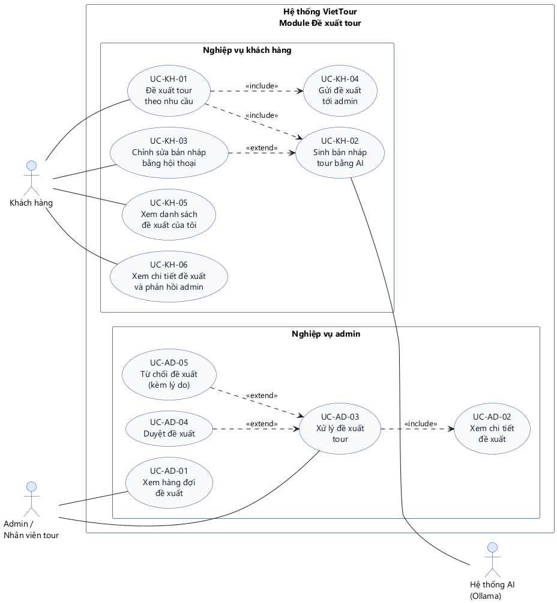
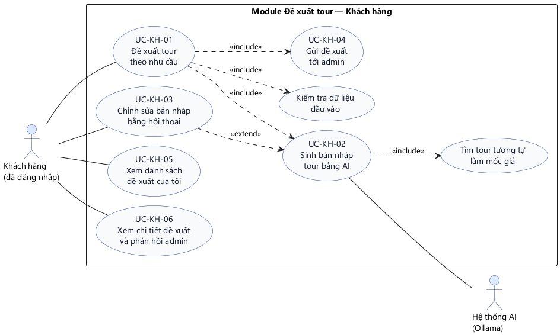
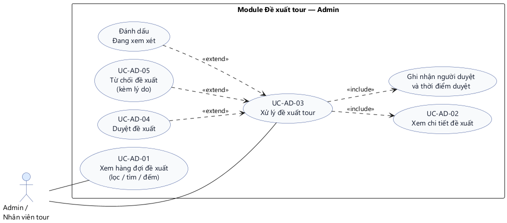
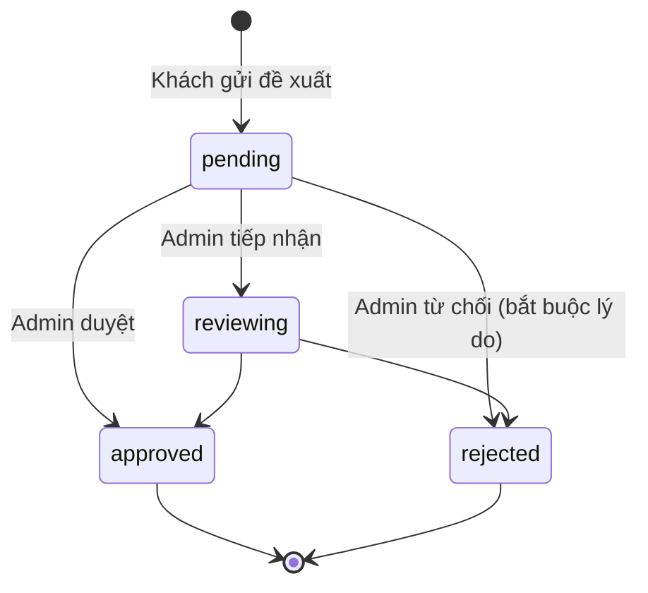

# Biểu đồ Use Case — Module Đề xuất tour

Thư mục này chứa biểu đồ use case của module **Đề xuất tour** (`tour_requests`), vẽ bám đúng luồng đang chạy trong mã nguồn (backend `src/features/tour-request/` + `src/features/admin/tour-requests/`, frontend `src/features/tour-requests/` + `src/features/admin/tour-requests/`).

| Tệp | Nội dung |
|---|---|
| `tong-quat.puml` | Biểu đồ use case tổng quát toàn module |
| `chi-tiet-khach-hang.puml` | Biểu đồ chi tiết nhóm Khách hàng (kèm include/extend) |
| `chi-tiet-admin.puml` | Biểu đồ chi tiết nhóm Admin (kèm include/extend) |
| `images/*.png` | Ảnh đã render, dùng để dán vào báo cáo |

---

## 1. Actor

| Actor | Loại | Vai trò trong module |
|---|---|---|
| **Khách hàng** | chính | Gửi nhu cầu, nhận bản nháp AI, gửi đề xuất, theo dõi kết quả |
| **Admin / Nhân viên tour** | chính | Xem hàng đợi, xem chi tiết, duyệt hoặc từ chối |
| **Hệ thống AI (Ollama)** | phụ (hệ thống ngoài) | Sinh bản nháp tour từ nhu cầu khách |
| CSDL MySQL | phụ | Lưu và truy vấn đề xuất — *không vẽ trong sơ đồ để tránh rối* |

> AI là **actor phụ**: khách không làm việc trực tiếp với AI, mà hệ thống gọi AI khi thực hiện UC-KH-02.

---

## 2. Danh sách use case

### Nhóm Khách hàng

| Mã | Tên use case | Quan hệ | Endpoint | Đã có |
|---|---|---|---|---|
| UC-KH-01 | Đề xuất tour theo nhu cầu | include UC-KH-02, UC-KH-04 | `POST /api/tour-requests` | ✅ |
| UC-KH-02 | Sinh bản nháp tour bằng AI | được include bởi UC-KH-01 | `POST /api/tour-requests/draft` | ✅ |
| UC-KH-03 | Chỉnh sửa bản nháp bằng hội thoại | extend UC-KH-02 | `POST /api/tour-requests/draft` | ✅ |
| UC-KH-04 | Gửi đề xuất tới admin | được include bởi UC-KH-01 | `POST /api/tour-requests` | ✅ |
| UC-KH-05 | Xem danh sách đề xuất của tôi | | `GET /api/tour-requests/mine` | ✅ |
| UC-KH-06 | Xem chi tiết đề xuất và phản hồi admin | | `GET /api/tour-requests/mine/:id` | ✅ |

### Nhóm Admin

| Mã | Tên use case | Quan hệ | Endpoint | Đã có |
|---|---|---|---|---|
| UC-AD-01 | Xem hàng đợi đề xuất (lọc / tìm / đếm) | | `GET /api/admin/tour-requests` | ✅ |
| UC-AD-02 | Xem chi tiết đề xuất | được include bởi UC-AD-03 | `GET /api/admin/tour-requests/:id` | ✅ |
| UC-AD-03 | Xử lý đề xuất tour | include UC-AD-02 | `PUT /api/admin/tour-requests/:id/status` | ✅ |
| UC-AD-04 | Duyệt đề xuất | extend UC-AD-03 | `PUT /api/admin/tour-requests/:id/status` | ✅ |
| UC-AD-05 | Từ chối đề xuất (kèm lý do) | extend UC-AD-03 | `PUT /api/admin/tour-requests/:id/status` | ✅ |

---

## 3. Biểu đồ use case tổng quát



- Hệ thống được giới hạn trong một khung (system boundary).
- Hai gói nghiệp vụ: **Khách hàng** và **Admin**.
- Actor phụ **Hệ thống AI** nối vào UC-KH-02.

---

## 4. Biểu đồ chi tiết — Khách hàng



Luồng thực tế:

1. Khách nhập nhu cầu (điểm đến, số ngày, số người, ngân sách, sở thích).
2. Hệ thống kiểm tra dữ liệu → tìm tối đa 5 tour tương tự làm mốc giá → gọi AI sinh bản nháp.
3. Khách xem bản nháp; nếu chưa ưng thì gửi góp ý, hệ thống sinh lại (giữ 20 tin nhắn gần nhất).
4. Khách bấm **Gửi đề xuất** → lưu `tour_requests` với `status = 'pending'`.

Giới hạn: **8 lượt sinh bản nháp / 15 phút** (rate limiter riêng, chặt hơn giới hạn chung của `/api`).

---

## 5. Biểu đồ chi tiết — Admin



Luồng thực tế:

1. Admin mở hàng đợi, thấy 4 thẻ đếm: Chờ duyệt / Đang xem xét / Đã duyệt / Từ chối.
2. Lọc theo trạng thái, tìm theo tiêu đề, điểm đến, tên / email / SĐT khách.
3. Mở chi tiết: nhu cầu khách, thông tin liên hệ, bản nháp AI (lịch trình, chi phí, dự toán).
4. Chọn trạng thái mới + ghi chú:
   - `reviewing` — đang xem xét
   - `approved` — duyệt
   - `rejected` — từ chối, **bắt buộc nhập lý do**
5. Hệ thống lưu `admin_note`, `reviewed_by`, `reviewed_at`.

---

## 6. Giải thích quan hệ include / extend

| Quan hệ | Cặp use case | Lý do |
|---|---|---|
| «include» | UC-KH-01 → UC-KH-02 | Muốn đề xuất tour thì **bắt buộc** phải sinh bản nháp bằng AI |
| «include» | UC-KH-01 → UC-KH-04 | Kết thúc luồng **luôn** phải gửi đề xuất tới admin |
| «include» | UC-KH-01 → Kiểm tra dữ liệu đầu vào | Bắt buộc validate trước khi gọi AI |
| «extend» | UC-KH-03 → UC-KH-02 | Chỉnh sửa là **tùy chọn**, chỉ xảy ra khi khách chưa hài lòng |
| «include» | UC-KH-02 → Tìm tour tương tự | AI luôn cần dữ liệu tour tham khảo để neo giá |
| «include» | UC-AD-03 → UC-AD-02 | Muốn xử lý thì phải xem chi tiết trước |
| «extend» | UC-AD-04 → UC-AD-03 | Duyệt là một nhánh tùy chọn của xử lý |
| «extend» | UC-AD-05 → UC-AD-03 | Từ chối là nhánh tùy chọn còn lại |
| «extend» | Đánh dấu "Đang xem xét" → UC-AD-03 | Chỉ dùng khi cần liên hệ khách / kiểm tra nhà cung cấp |

---

## 7. Trạng thái đề xuất



> Backend hiện chỉ kiểm tra **giá trị** trạng thái hợp lệ, chưa chặn **chuyển trạng thái ngược** (ví dụ `approved → pending` vẫn lưu được). Nếu báo cáo có nêu state machine thì ghi rõ đây là hạn chế của phiên bản hiện tại.

---

## 8. Ánh xạ use case → API → dữ liệu

| Use case | API | Bảng đọc/ghi |
|---|---|---|
| UC-KH-02 | `POST /api/tour-requests/draft` | đọc `tours`, `tour_itineraries`, `tour_services`, `tour_departures` |
| UC-KH-01 / UC-KH-04 | `POST /api/tour-requests` | ghi `tour_requests` |
| UC-KH-05 | `GET /api/tour-requests/mine` | `tour_requests` |
| UC-KH-06 | `GET /api/tour-requests/mine/:id` | `tour_requests` |
| UC-AD-01 | `GET /api/admin/tour-requests` | `tour_requests` + `users` |
| UC-AD-02 | `GET /api/admin/tour-requests/:id` | `tour_requests` + `users` |
| UC-AD-03/04/05 | `PUT /api/admin/tour-requests/:id/status` | cập nhật `tour_requests` |

---

## 9. Những điểm chưa có trong sơ đồ

Các mục dưới đây **chưa được triển khai**, nên cố tình không vẽ để sơ đồ khớp với code:

| Thiếu | Ảnh hưởng | Hướng bổ sung |
|---|---|---|
| Không có thông báo cho admin | Admin chỉ thấy khi tự vào trang; không có email / badge | Gửi mail qua `mailService` + badge trên sidebar |
| Duyệt xong không tạo tour | Đề xuất được duyệt nhưng không dẫn tới tour thật | Thêm UC-AD-06 "Tạo tour nháp từ đề xuất đã duyệt" |
| Khách không sửa / hủy được đề xuất | Đã gửi là cố định | Thêm UC-KH-07 "Hủy đề xuất" khi còn `pending` |
| Không chặn chuyển trạng thái ngược | Dữ liệu có thể sai luồng | Kiểm tra transition ở service |
| Không có log lịch sử xử lý | Chỉ biết lần duyệt cuối | Thêm bảng `tour_request_logs` |

---

## 10. Cách render lại

Yêu cầu: Java 17+ và Graphviz (`dot`). Trong repo đã có sẵn `plantuml.jar` và Graphviz portable trong `tools/`.

```powershell
cd D:\Do_An_VietTour
$env:GRAPHVIZ_DOT = "D:\Do_An_VietTour\docs\uc\tools\Graphviz-12.0.0-win64\bin\dot.exe"
java "-Dfile.encoding=UTF-8" -jar docs\uc\plantuml.jar -tpng -charset UTF-8 -o images `
  docs\uc\tong-quat.puml docs\uc\chi-tiet-khach-hang.puml docs\uc\chi-tiet-admin.puml
```

Xuất SVG (nét hơn khi in báo cáo):

```powershell
java "-Dfile.encoding=UTF-8" -jar docs\uc\plantuml.jar -tsvg -charset UTF-8 -o images docs\uc\*.puml
```

> `tools/` và `plantuml.jar` chỉ phục vụ render, có thể thêm vào `.gitignore` nếu không muốn commit (~22 MB).
